
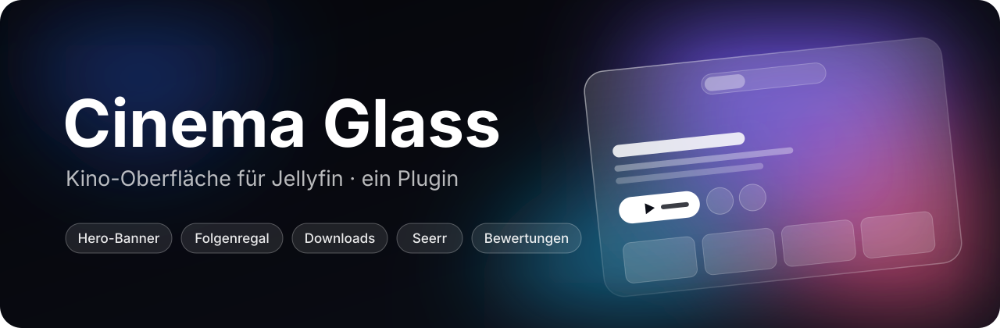

  
  
  
  

# Cinema Glass – Kino-Oberfläche für Jellyfin

Eine Oberfläche für die Jellyfin-Weboberfläche (getestet mit Jellyfin 12.4) im Stil moderner Fernseh-Apps: Hero-Banner,
Glasflächen, ruhige Typografie. Dazu Funktionen, die über ein Theme hinausgehen und Schwächen von Jellyfin und anderen Plugins ausbügeln – alle einzeln schaltbar.

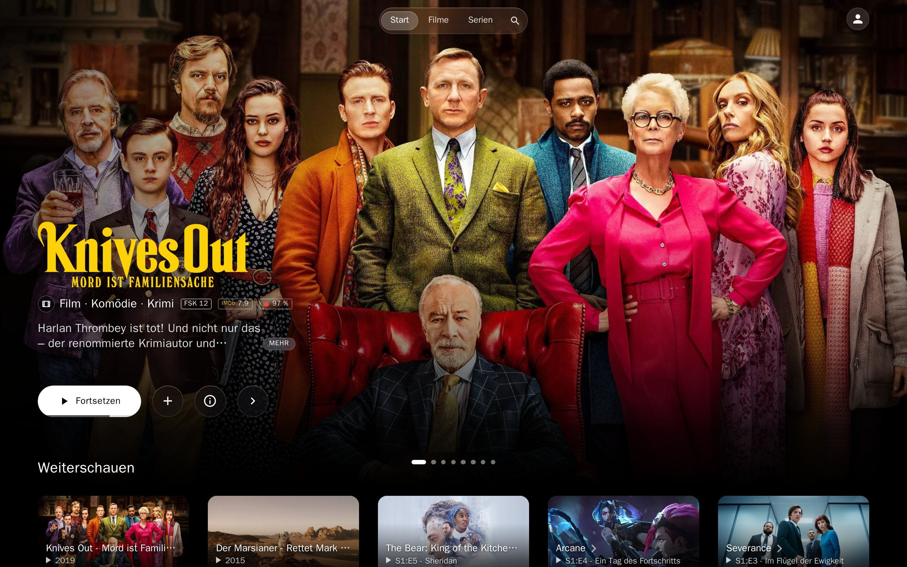

## Was es kann

| | |
|---|---|
| **Serienseite mit Folgenregal** – Staffelwahl, Fortschritt, Besetzung 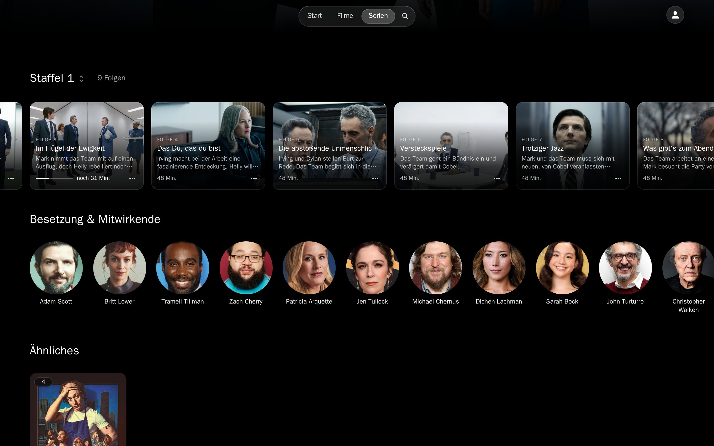 | **Filmseite** – Logo, Bewertungen, Fassungen wie bei den Staffeln wählbar 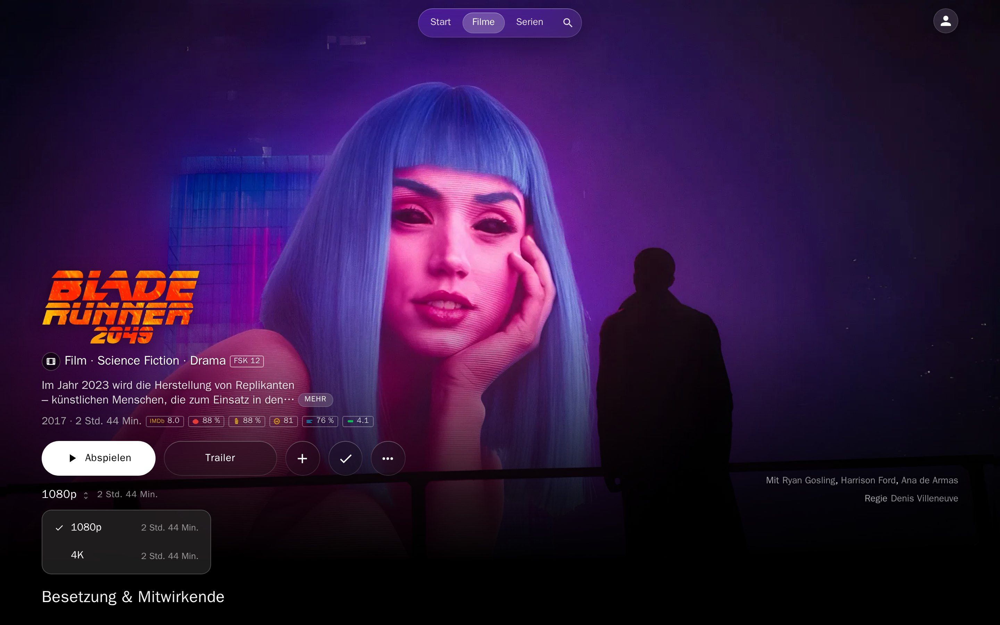 |
| **Suche findet auch, was fehlt** – Regal „Nicht in deiner Mediathek“ über Seerr 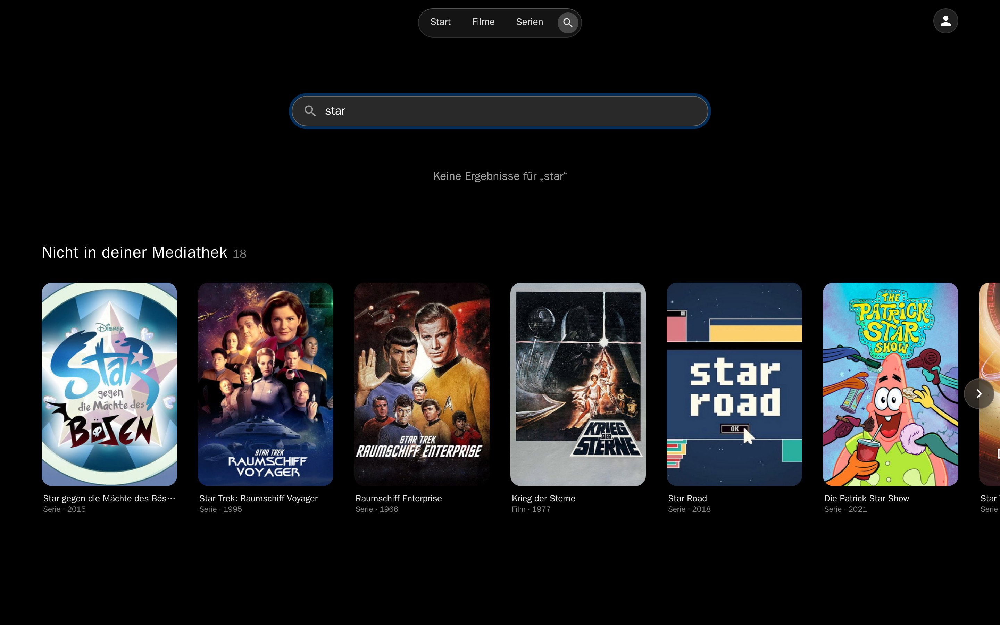 | **Anfragen ohne Umweg** – Staffeln und Qualitätsprofil direkt wählen 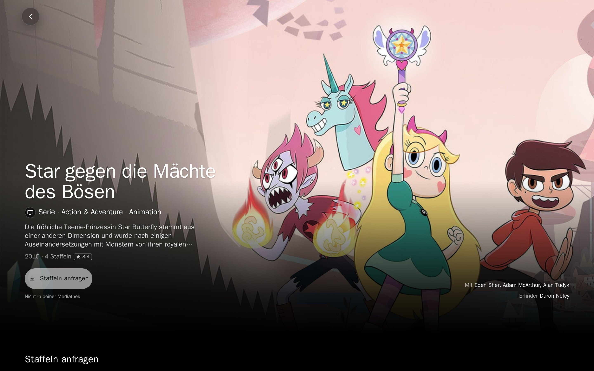 |
| **TV-Seite** – Live-Programm und Mediathek auf einer Seite (mit dem Plugin „Mediathek“)  | **Mediathek wie eine Bibliothek** – Reihen, Suche, Serien mit Staffeln; Karten spielen direkt ab 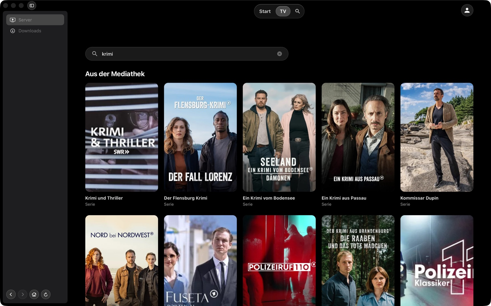 |
| **Regale auf der Startseite** – Karten spielen direkt ab 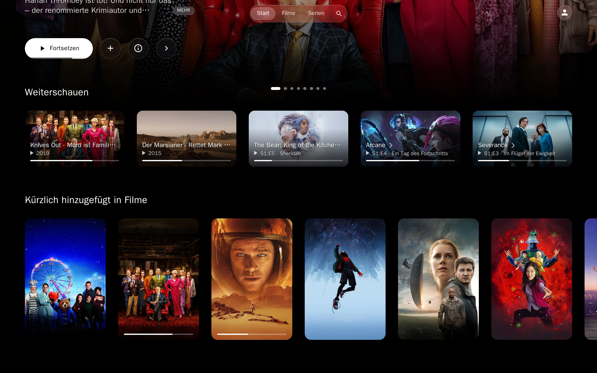 | **Alles schaltbar** – eine Einstellungsseite im Dashboard 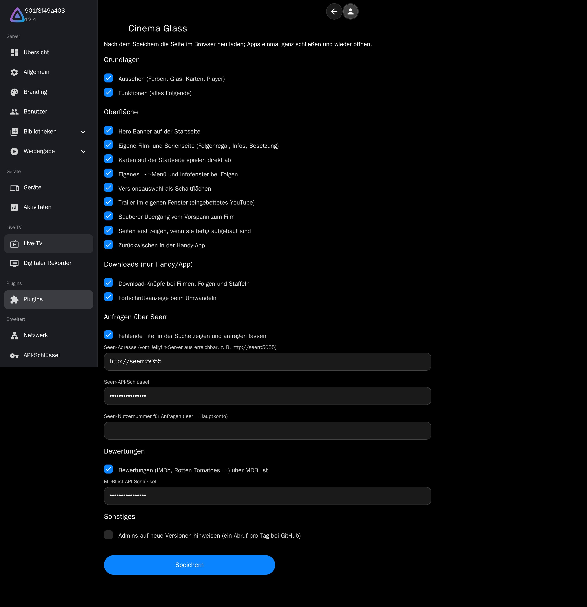 |

  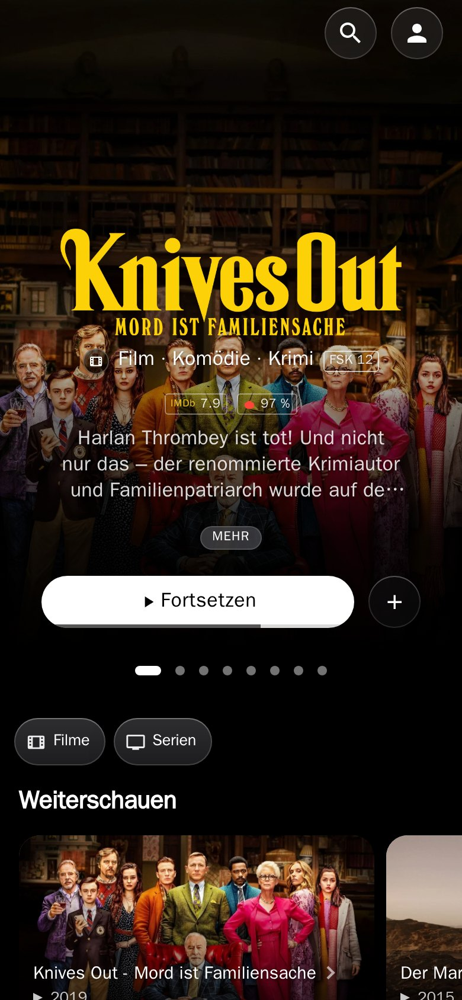
  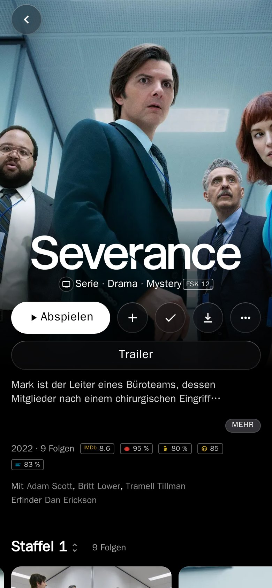
  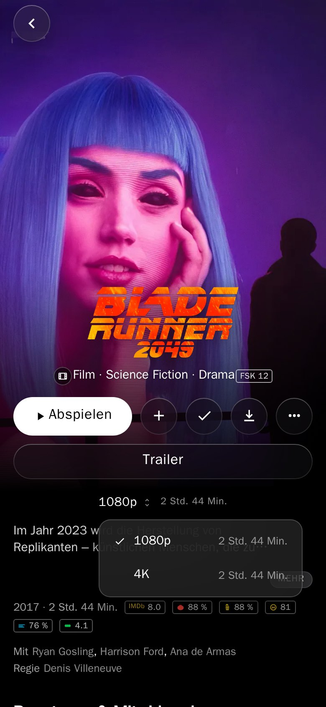
  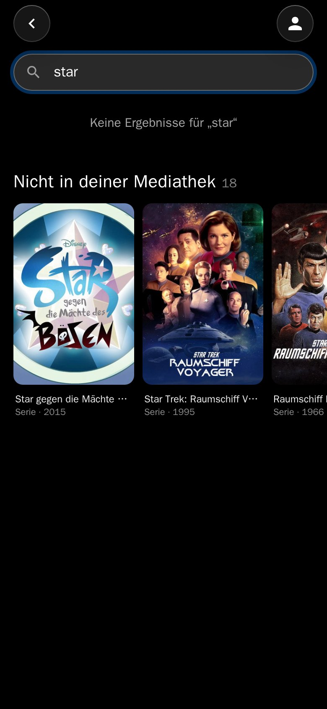
  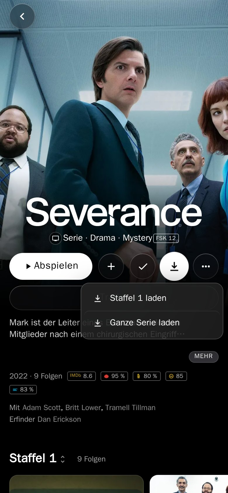

## Mehr als ein Theme: was es an Jellyfin und anderen Plugins glattzieht

Ein Teil der Funktionen ist kein Aussehen, sondern behebt Stellen, an denen Jellyfin, seine Apps oder andere Plugins haken.

| Wo es hakt | Ohne Cinema Glass | Mit Cinema Glass |
|---|---|---|
| **Vorspann ([Local Intros](https://github.com/dkanada/jellyfin-plugin-intros))** | Während des Vorspanns steht dessen Dateiname im Player. Zwischen Vorspann und Film bleibt das letzte Bild des Vorspanns stehen oder es wird schwarz. Eine gewählte Fassung wird ignoriert. | Kein Titel während des Vorspanns, in der Lücke steht das Hintergrundbild des Films, der Film wird schon vorgeladen, die gewählte Fassung startet. |
| **Trailer** | Jellyfins eigene Trailer-Wiedergabe endet in den Apps oft mit „Wiedergabefehler“. | Der hinterlegte Trailer läuft in einem eigenen Fenster. Gibt es keinen, erscheint der Knopf gar nicht erst. |
| **Mac-App [JellyDesk](https://github.com/derpfiff/JellyDesk)** | Am Rechner gibt es keine Downloads und keine Offline-Wiedergabe. | Download-Knöpfe auch am Mac, die App lädt und spielt offline ab; das Vollbild läuft über das Fenster der App und damit ohne Sprung. Der Play-Knopf startet den Player der App, der jede Datei unverändert abspielt (DTS, TrueHD, Bild-Untertitel), ohne dass der Server umrechnet. |
| **Downloads in der Jellyfin-App** | Die App kann herunterladen, der Befehl steckt aber im Menü einzelner Titel – nicht für ganze Staffeln oder Serien – und es gibt keinen Fortschritt, solange der Server umwandelt. | Download-Knopf bei Film, Folge, Staffel und ganzer Serie, dazu eine Fortschrittsanzeige. Die gewählte Qualität gilt auch, wenn in der App „transkodierte Downloads“ eingeschaltet ist (nur dann spielt die App Geladenes selbst ab): Das Plugin setzt sie in der Anfrage der App durch. |
| **Mehrere Fassungen ([Merge Versions](https://github.com/danieladov/jellyfin-plugin-mergeversions))** | Die Auswahl steckt in einem unscheinbaren Aufklappfeld. | Auswahl wie bei den Staffeln, mit Laufzeit je Fassung. |
| **Fehlende Titel ([Seerr](https://github.com/seerr-team/seerr))** | Eigene Webseite, eigene Anmeldung. | Regal „Nicht in deiner Mediathek“ in der Suche und auf Personenseiten, Anfrage mit Staffeln und Qualitätsprofil an Ort und Stelle. |
| **„···“ bei Folgen** | Öffnet eine eigene Seite, von der man wieder zurück muss. | Kleines Menü an Ort und Stelle, „Details“ als Infofenster. |
| **Zurück in der iOS-App** | Keine Wischgeste – nur der Zurück-Knopf. | Vom Rand wischen, die vorherige Seite liegt sichtbar darunter. |
| **Seitenaufbau** | Seiten erscheinen halb fertig, Regale und Bilder springen nach. | Die Seite erscheint erst, wenn sie fertig aufgebaut ist. |
| **Karten auf der Startseite** | Ein Tipp auf eine Folge führt erst zur Serienseite. | Bild und ▶-Zeile spielen direkt ab, die Titelzeile öffnet die Seite. |
| **Player und [Intro Skipper](https://github.com/intro-skipper/intro-skipper)** | Standard-Bedienleiste; der Überspringen-Knopf passt optisch nicht dazu. | Bedienleiste, Titelzeile und Überspringen-Knopf im selben Glas-Stil. |

| | |
|---|---|
| **Zurückwischen** – die Startseite liegt unter der Serienseite 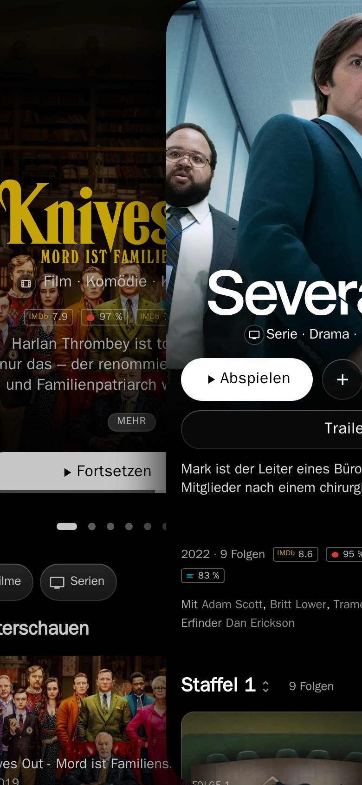 | **Folgenmenü und Infofenster** statt Seitenwechsel 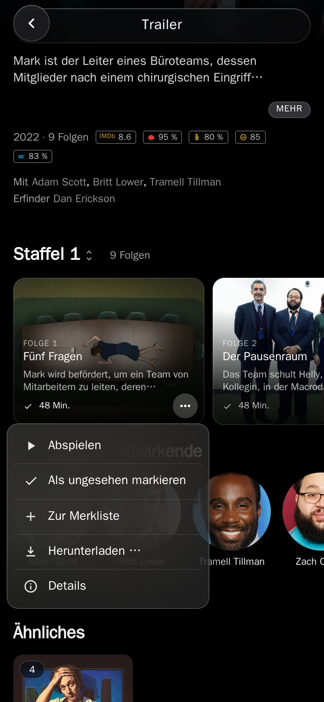 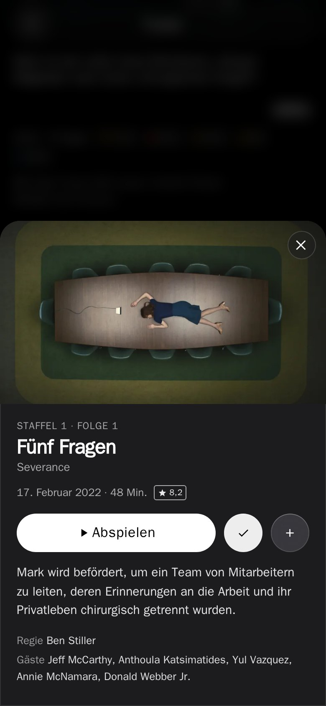 |
| **Player** im selben Stil 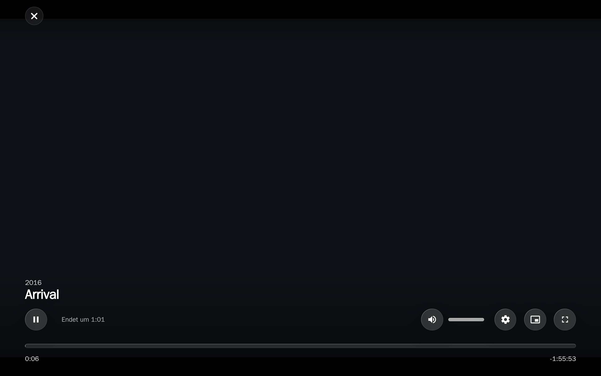 | **Anmeldung** 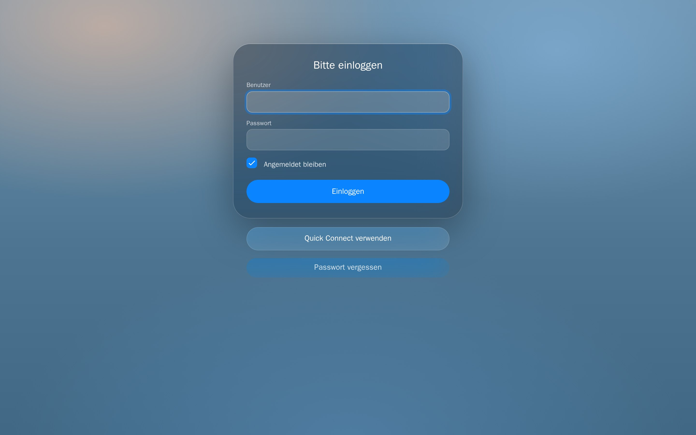 |

Jeder dieser Punkte hat einen eigenen Schalter in den Einstellungen. Vorspann, Trailer und Seitenaufbau lassen sich auf
einem Standbild nicht zeigen – dafür gibt es keine Bildschirmfotos.

Die Bildschirmfotos stammen aus einer Testinstanz mit leeren Platzhalter-Videos. Plakate und Texte kommen von TMDb und gehören den jeweiligen Rechteinhabern; sie sind nicht Teil dieses Projekts.

Das Plugin selbst enthält keine fremden Grafiken oder Schriften. Die Systemschrift wird nur per Name angefordert.

## Installation (empfohlen): Plugin

1. Dashboard → Plugins → Kataloge → hinzufügen:
   `https://raw.githubusercontent.com/derpfiff/cinema-glass/main/manifest.json`
2. **Cinema Glass** installieren, Jellyfin neu starten.
3. Dashboard → Plugins → Cinema Glass: Funktionen wählen, bei Bedarf Seerr und MDBList eintragen.

Alles Weitere: [docs/PLUGIN.md](docs/PLUGIN.md).

## Passende Plugins (alle freiwillig)

Cinema Glass läuft allein. Diese Plugins und Dienste ergänzen einzelne Funktionen. Fehlt eines, bleibt nur die
jeweilige Funktion unsichtbar – es gibt keine Fehlermeldung und nichts geht kaputt.

| Plugin / Dienst | Wofür | Ohne |
|---|---|---|
| **[Fanart](https://github.com/jellyfin/jellyfin-plugin-fanart)** (Katalog „Jellyfin Stable“) | Titel-Logos und zusätzliche Hintergrundbilder | Titel stehen als Text da, weniger Bilder |
| **[Local Intros](https://github.com/dkanada/jellyfin-plugin-intros)** (Katalog „Jellyfin Stable“) | eigener Vorspann vor Filmen; Cinema Glass sorgt für den sauberen Übergang | kein Vorspann, der Film startet direkt |
| **[Intro Skipper](https://github.com/intro-skipper/intro-skipper)** (eigenes Repository des Plugins) | Knopf „Intro überspringen“ bei Serien, im Stil der Oberfläche | kein Überspringen-Knopf |
| **[Merge Versions](https://github.com/danieladov/jellyfin-plugin-mergeversions)** (eigenes Repository des Plugins) | fasst mehrere Fassungen eines Films zusammen; Cinema Glass zeigt dann die Versionsauswahl | keine Versionsauswahl (geht auch von Hand über „Versionen gruppieren“) |
| **[Mediathek](https://github.com/derpfiff/jellyfin-mediathek)** (eigenes Repository des Plugins) | Live-TV und Mediathek der öffentlich-rechtlichen Sender; Cinema Glass macht daraus die TV-Seite (Sender je Konto aus- und einblendbar, „Weiterschauen“ mit gemerkter Stelle, auf dem Handy über den Chip „TV“ der Startseite, Herunterladen in JellyDesk und in der Jellyfin-App) und zeigt Treffer in der Suche als „Aus der Mediathek“ | kein Eintrag „TV“ (bzw. nur Jellyfins eigenes Live-TV) |
| **[Seerr](https://github.com/seerr-team/seerr)** (Jellyseerr/Overseerr, eigener Dienst) | fehlende Titel in der Suche finden und anfragen | kein Regal „Nicht in deiner Mediathek“ |
| **[MDBList](https://mdblist.com)** (kostenloser API-Schlüssel) | Bewertungen von IMDb, Rotten Tomatoes usw. | keine Bewertungs-Plaketten |

Der **[JavaScript Injector](https://github.com/n00bcodr/Jellyfin-JavaScript-Injector)** wird mit dem Plugin nicht mehr gebraucht. Einrichtung der einzelnen Plugins: [docs/SETUP.md](docs/SETUP.md).

## Installation von Hand (ohne Plugin)

Geht weiterhin, dann aber ohne Einstellungsseite – alle Funktionen sind an. Seerr-Anfragen und Bewertungen gibt es nur mit dem Plugin.

| Datei | Zweck |
|---|---|
| `css/appletv.css` | gesamtes Styling |
| `js/appletv.js` | Hero-Banner, Regale, Detailseite, Player, Downloads usw. |

1. **CSS:** Dashboard → Allgemein → Branding → *Eigenes CSS*: Inhalt von `css/appletv.css` einfügen und speichern.
2. **JS:** Das Plugin **[JavaScript Injector](https://github.com/n00bcodr/Jellyfin-JavaScript-Injector)** installieren (Katalog: Dashboard → Plugins) und Jellyfin neu starten.
   Im Plugin ein Skript anlegen, den Inhalt von `js/appletv.js` einfügen und aktivieren.
3. Browser neu laden (Strg+F5). Auf Smart-TV- oder Handy-Apps, die den Web-Client nutzen, die App neu starten.

## Server-Setup

Plugins, Bildquellen (Fanart), Vorspann und Trailer: siehe [docs/SETUP.md](docs/SETUP.md).

## Entfernen

Plugin: deinstallieren und Jellyfin neu starten. Handinstallation: das eigene CSS im Branding leeren und die Skripte im JavaScript Injector deaktivieren oder löschen. Danach den Browser neu laden.
